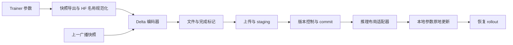
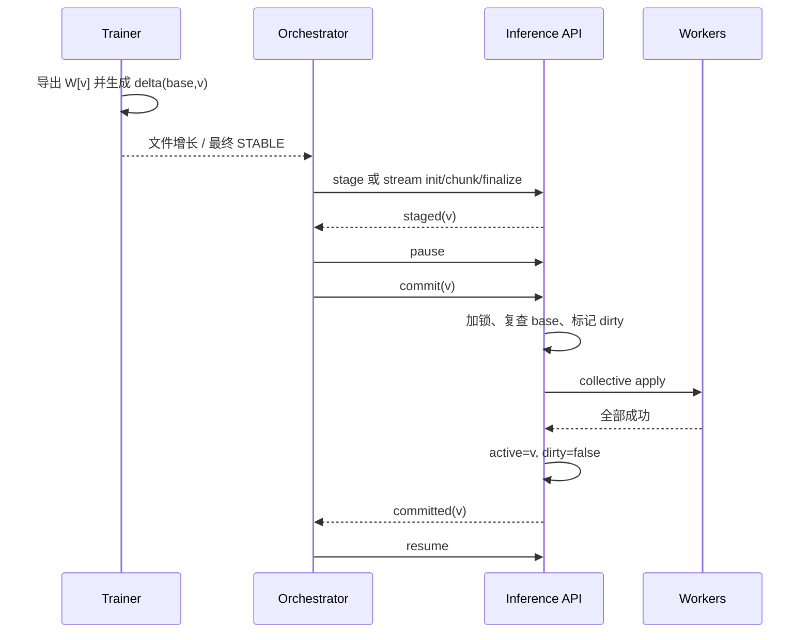

# Sparse Delta Checkpoints 设计文档

## 1. 目的与适用范围

本文定义将本仓库 sparse delta 权重广播能力移植到其他 RL 框架时应保留的语义、组件边界、运行流程与验收标准。配套文档为 [接口文档](sparse_delta_interfaces.md)。

实现基线：提交 `317ece8011820417ce28d8ab7d72f8bbfec48277`，包含 `utils/delta.py::_extract_changed_values` 的 FP64 二次提升逻辑。

文中的“当前实现”描述已有代码；“移植要求”是目标框架必须实现的集成约束；“可选扩展”尚未在当前实现中完整提供。必须（MUST）、应当（SHOULD）、可以（MAY）分别表示必要条件、推荐条件和可选项。

### 1.1 目标

- 在保证广播目标权重数值可精确还原的前提下，减少 trainer 到 rollout/inference worker 的权重传输量。
- 将训练并行布局、逻辑权重格式、推理并行布局分离。
- 支持提取与上传重叠，并在可控的推理暂停窗口内应用更新。
- 明确版本依赖、失败隔离与推理节点恢复方式。

### 1.2 非目标与支持边界

这是模型权重同步产物，不包含 optimizer、scheduler、RNG、数据游标等完整训练恢复状态。当前 delta 模式不支持从非零训练 checkpoint 直接恢复；配置层对显式 `resume_step` 还有更严格限制，移植时先禁用 resume。

当前推理适配器支持未量化 dense 模型的 Qwen3/Llama 风格 HF 名称、融合 QKV/gate-up、replicated、row/column/vocab TP，以及 GQA 的 KV head 复制。TP 数量必须满足模型和推理引擎的分片约束。LoRA、量化/packed weights、MoE/expert parallel、PP>1 和非标准融合布局不在本次最小移植范围内。派生权重刷新钩子的存在不意味着所有模型架构都已支持。

## 2. 核心语义与不变量

设 `W[v]` 为广播版本 `v` 的逻辑权重快照。每个参数展平后：

```text
I[v] = {i | W[v][i] != W[base_version][i]}
D[v] = W[v][I[v]] - W[base_version][I[v]]
W[v][I[v]] = cast_to_weight_dtype(W[base_version][I[v]] + D[v])
```

加法必须使用与差值精度相容的 dtype。未出现在记录中的位置保持原值。`D` 存储加法差值，不存储目标权重。空 delta 合法，仍代表一次版本推进。

移植必须维持以下不变量：

| 编号 | 不变量 |
|---|---|
| INV-01 | base 与 target 使用相同参数集合、shape、dtype 和命名规则；共享参数按明确规则规范化 |
| INV-02 | 快照在提取期间及作为后续 base 使用期间不可变，不能引用仍在被 optimizer 原地修改的 storage |
| INV-03 | 推理端应用前的有效权重必须等于该 delta 对应的 base，只有版本号相同不足以证明内容相同 |
| INV-04 | 每个逻辑参数的索引是有界、唯一、严格递增的 int64；values 与索引一一对应 |
| INV-05 | delta 必须按依赖链应用一次；不得跳版本、重复加法或合并后假设相同的浮点舍入结果 |
| INV-06 | 同一推理模型的 commit/reload 串行执行，应用期间不执行与之冲突的推理 |
| INV-07 | 应用失败的节点必须退出路由，恢复正确基座和更新链前不得恢复服务 |
| INV-08 | 提取完成前不得发布完成标记；仅完成 staging 的文件可以进入 commit |

“精确”针对传输快照的数值相等，不保证训练内部高精度状态、NaN payload 或正负零的位模式。目标框架首版必须将支持域限制为有限浮点权重，并在发布前拒绝非有限值；这是移植要求，当前提取器没有统一的有限值预检。

## 3. 架构与组件职责



| 组件 | 当前实现 | 移植职责 |
|---|---|---|
| 快照导出 | `trainer/weights.py::gather_weights_on_master` | 接入目标框架 FSDP/ZeRO/TP，导出稳定的全局逻辑 tensor |
| 广播管理 | `trainer/rl/broadcast/filesystem.py::FileSystemWeightBroadcast` | 管理每条更新链的初始与前一快照、产物和完成事件 |
| 差分编解码 | `utils/delta.py::ModelDeltaManager` | 保留算法和 v2 格式，可独立复用 |
| 更新调度 | `orchestrator/scheduler.py::Scheduler` | 按连续版本推进，后台 stage，控制消费时机 |
| 传输与恢复 | `utils/client.py` | stage/commit、暂停与恢复、故障节点隔离和链重放 |
| 服务端控制面 | `inference/vllm/server.py` | staging、版本检查、串行 commit/reload、dirty 状态 |
| 布局转换 | `inference/vllm/worker/weight_layout.py` | 从 HF 全局索引映射到推理本地参数及索引 |
| 参数更新 | `inference/vllm/worker/weight_transfer.py` | 保留差值精度，执行原地加法，刷新必要派生状态 |

上述路径均位于 [`src/prime_rl/`](../src/prime_rl/)。移植应复用格式和纯数据逻辑，重新实现依赖目标框架生命周期的导出、调度及推理控制层。

## 4. 数据面设计

### 4.1 快照导出与基座

当前训练端先 gather，再转换回 HF 名称。`gather_weights_on_master` 默认将 DTensor 转为 BF16 后调用 `full_tensor()`，仅 master 保留 CPU tensor；普通非 DTensor 分支不统一强制转为 BF16。因此，传输 dtype 不能仅从训练配置推断。

初始化写出完整 step 0 权重，并让每个 run 的 `_prev_state_by_run` 指向初始快照。每次产物提取成功后，前一快照推进到 target；这发生在远端 commit 确认之前。`_initial_state` 仍保留用于回退。

移植要求：

1. 在 optimizer step 的一致性边界导出，所有必需 rank 参加 collective；不能只让 master 调用需要其他 rank 参与的 gather。
2. 显式约定传输 dtype，导出结果应当为独立、连续的 CPU tensor；异步拷贝完成前不能发布快照。
3. 推理端首次加载相同的规范化基座。当前运行依赖初始模型一致；写出 step 0 不等于服务端已自动加载或验证这份文件。
4. 广播版本使用独立的连续编号 `0,1,2,...`；额外记录 optimizer step。若每 10 步广播一次，不能直接把 `10,20` 代入当前要求连续版本的 scheduler/replay。
5. 每个产物写入完成后才推进 producer 的前一快照；远端尚未确认时保留该产物。发生提取失败时，旧 base 不变且不得留下完成标记。

当前 tied-weight 处理仅在 base 和 target 中 embedding 与 `lm_head.weight` 均形状相同且数值相等时跳过 head；它并不检查实际 storage alias。目标框架必须用模型的真实共享参数关系确认这种省略合法，否则应同时保留两个逻辑参数，并在应用时避免对同一 storage 重复加法。

### 4.2 稀疏提取与精度

正常广播路径以 `target != base` 选取全部变化位置，阈值为零，包含 bias。底层历史接口存在 threshold 能力，但不得将有损 threshold/top-k 作为本规范的无损模式实现。

每个 tensor 先按原 dtype 计算差值并检查重建：

```text
原 dtype 差值可还原目标 → 保存原 dtype values
否则 FP16/BF16 → FP32 values；其他浮点 dtype → FP64 values
若仍失败且不是 FP64 → 再尝试 FP64
仍不能还原 → 提取失败，不发布产物
```

提升发生于该 tensor 的全部选中 values，不改变模型参数 dtype，更不能改变训练 `optimization_dtype` 或 `reduce_dtype`。推理端必须先按提升后的精度相加，再 cast 到参数 dtype。

### 4.3 索引与记录

v2 记录使用 HF 全局名称、全局 shape、展平索引和差值。`optimized` 编码保存相邻索引差的 unsigned varint；`naive` 使用 int32 或 int64。保留 global shape 是推理端还原坐标、执行 TP 过滤及融合偏移计算的依据。

当前支持 `delta.safetensors` 和 `delta.stream`，二者携带相同逻辑更新。字段和二进制布局见 [接口文档第 4 节](sparse_delta_interfaces.md#4-文件格式契约)。v1 仅作为历史读取兼容；新写入应使用 v2。

### 4.4 Streaming 的重叠边界

`delta.stream` 按 tensor 追加写入，非 layer 参数先写，layer 参数按层号排序。`group_size=4` 按 `layer_index // 4` 划分 flush 组；非 layer 参数各自触发 flush；`0` 表示每条记录对应的处理边界 flush。flush 不等于 fsync，也不等于固定网络 chunk 大小。

后台 uploader 在文件出现后开始读取已写出的字节；暂时到达 EOF 时继续等候，只有 `STABLE` 出现且最终字节全部上传后才 finalize。服务端验证完整范围、最终长度和客户端提供的 SHA-256，再将临时文件改名并登记 staging。

当前仍先完成全量 gather，再逐 tensor 提取；它重叠的是提取、文件输出和上传，不是分层 gather 与推理应用。文件没有结束记录或内嵌总长度，所以边界恰好落在完整 record 后的截断不能仅靠解析器发现，必须依赖外层完成信号和完整性检查。

### 4.5 推理布局与原地应用

推理适配器将 `(HF name, global shape, indices, values)` 转为 `(local parameter name, local indices, local values)`：

- replicated：所有 rank 更新相同位置。
- row/column parallel：按参数实际 input/output dimension 选择本 rank 分片并重编号。
- vocab parallel：使用引擎的词表起止位置，正确处理 padding。
- fused QKV、gate/up：分别处理来源分片、融合偏移和本 rank 布局。
- GQA：根据 Q/KV heads 与 TP 关系处理复制，不能把 Q/K/V 一律等分。

更新必须保留原 Parameter/storage，以兼容引用该存储的执行图；非连续参数目前拒绝处理。空的本地更新是合法 no-op。当索引覆盖整个本地 tensor 且 dtype 相同时使用 `add_`，其他情况使用 gather、提升精度相加、cast 和 `index_copy_`。

首版移植必须定义更新后的 KV/prefix cache、在途序列及派生权重策略。当前客户端 pause 使用 `mode="keep", clear_cache=False`，不能据此推断全量权重 commit 已自动清空旧 KV。目标框架可选择取消并重建在途请求或采用经验证的跨版本策略，但必须保证不向新版本 rollout 复用无效的旧权重缓存。

## 5. 控制面与版本状态

### 5.1 正常时序



stage 不修改模型；commit 才应用。当前 `/commit` 本身不执行 pause，由客户端包装器调用 `/pause`、`/commit`、`/resume`。直接接 HTTP API 的新框架必须承担这一职责。

### 5.2 节点状态机

| 状态 | 允许操作 | 转移 |
|---|---|---|
| CLEAN(base) | 推理、接收依赖 base 的 stage | stage 成功后权重仍为 base |
| STAGED(base,v) | 保持旧模型推理、等待 commit | pause 后进入 APPLYING |
| APPLYING | 禁止冲突推理；dirty=true | 全 worker 成功进入 CLEAN(v)，异常进入 DIRTY |
| DIRTY | 禁止恢复服务、禁止继续 delta | 隔离节点，reload 成功后重放链 |
| RECOVERING | 不参与正常路由 | 达到目标版本并完成验证后恢复服务 |

上述是概念状态；当前代码用 `active_version`、`staged_versions`、`weights_dirty` 和客户端健康状态分别表达。服务端初始 `active_version=None` 在 delta 校验时解释为 `"0"`。

当前 commit 使用进程内锁并复查 base；重复提交仍保留 staging 条目的当前 active 版本不会重复本地加法，可以重试 relay fan-out。后续版本提交后旧条目被清理，旧 commit 不保证持续幂等。stage 也不是通用幂等查询接口：已经激活后重新 stage 相同 delta 会因 base 不匹配而失败。

API 状态仅存在单 API server 进程中，因此要求每个 endpoint 一个 API server。多个推理 endpoint 不构成跨节点原子事务；某些节点成功、某些节点失败时必须隔离失败节点，并按调度策略选择一致的服务集合。

## 6. 失败处理与恢复

| 故障 | 当前影响 | 移植处理 |
|---|---|---|
| 提取失败或 producer 退出 | 文件可能只写入一部分，没有 STABLE | 不 finalize；设置生产者存活检查和等待期限，清理未发布产物 |
| 上传丢块/长度或 hash 不匹配 | finalize 拒绝，权重未变 | 按 offset 重传相同字节或重新初始化上传 |
| base_version 不匹配 | stage/commit 拒绝 | 查明节点状态；不得修改版本标签绕过检查 |
| worker 应用到一半失败 | 权重可能部分改变，dirty 保留 | 退出路由，reload 基座并完整重放；不能直接重试 delta |
| commit 响应丢失 | 可能已成功，也可能未完成 | 同一存活服务端可重试 commit；若版本状态丢失/不确定则 reload/replay |
| API 或 worker 重启 | 控制状态或参数状态可能丢失 | 不假设磁盘 delta 等于内存版本，重新建立基座 |
| relay peer 失败 | seed 可能已成功 | 对服务中的 peer 保持 fail-on-peer-error，隔离受影响区域并恢复 |
| 历史 delta 被删除 | 更新链不完整 | 不跳过缺口；从可验证完整快照重建或停止恢复 |

当前 `retain_all_deltas=true` 只是阻止 trainer 清理广播产物；客户端 replay 索引和 API 版本状态仍在内存。不能据此承诺 orchestrator 崩溃后的自动恢复。当前恢复通过 `/reload_weights` 重新加载引擎配置的基座，再按版本 1 到目标版本顺序重放，并非自动读取 trainer 的 step 0 目录。

可选扩展：持久化更新链 manifest、模型基座内容指纹、同版本不同 hash 冲突检测、可查询的版本状态、完整 anchor checkpoint 和确认驱动的 GC。加入 anchor 后必须同时修改 reload、replay 起点和版本验证，不能只新增一个 full 文件就宣称支持断点恢复。

## 7. 成本、指标与保留策略

若完整权重每元素 `b` 字节，变化比例 `p`，索引平均 `i` 字节、values 平均 `d` 字节，则忽略 metadata：

```text
delta_bytes / full_bytes ≈ p × (i + d) / b
```

例如 BF16 权重、1 字节索引和 2 字节差值时，比例约为 `1.5p`。差值提升和稠密变化会降低收益。当前没有自动按密度切换 full 的机制。

全量 gather、O(N) 参数扫描和 CPU 快照仍然存在。初始化、前一和当前快照以及多 run 引用可能同时存活；safetensors 路径还会累计全部稀疏记录。stream 路径降低记录累计内存，但不会消除完整快照成本。

当前 `DeltaStats` 提供参数数、变化比例、完整/差分 MiB 和压缩比；scheduler 记录 stage/commit 等时间。移植应补充：gather/extract/apply 时间、CPU/GPU 峰值内存、网络字节、节点版本滞后、dirty 次数、重放时间及队列长度。验收必须与 full 广播基线比较同一模型、同一更新序列，不将示例压缩率作为承诺。

首版保留完整链。生产系统应限制未确认版本积压和磁盘用量；清理依据是所有需恢复消费者的确认水位与可用 anchor，而不只是“最近几个文件”。

## 8. 移植实施计划与验收

| 阶段 | 交付物 | 通过条件 |
|---|---|---|
| P0 范围确认 | 目标模型、并行策略、传输 dtype、基座来源、推理引擎清单 | 所有不支持布局在启动前明确拒绝 |
| P1 数据闭环 | CPU 快照导出、v2 编码/解码、离线重建 | 每个支持 dtype 的有限测试权重严格还原；空 delta、bias、跨符号和精度提升通过 |
| P2 单节点集成 | TP=1、safetensors、shared_fs、stage_commit | full 与 delta 目标权重相同；暂停与缓存策略明确；错 base 拒绝 |
| P3 并行布局 | 目标引擎 adapter、实际 TP 模型验证 | 各 rank 参数与 full loader 一致，覆盖 QKV/GQA/gate-up/vocab/tied weights |
| P4 流式与恢复 | streaming upload、dirty 隔离、reload/replay | 半文件不提交，丢块和 hash 错误拒绝，部分应用失败后恢复到目标版本 |
| P5 性能准入 | full/delta 对照报告、保留与背压策略 | 正确性零退化；在目标负载下满足预先确定的暂停时长、内存和带宽预算 |

必须验证的异常场景：重复 commit、旧版本重试、缺失链中间项、producer 在写 record 时退出、worker 在第一个成功更新后失败、API 重启、不同内容伪装相同版本、全体 endpoint 暂时不可用。

可复用现有用例：[`test_delta.py`](../tests/unit/utils/test_delta.py)、[`test_filesystem_broadcast.py`](../tests/unit/train/rl/test_filesystem_broadcast.py)、[`test_weight_transfer.py`](../tests/unit/inference/test_weight_transfer.py)、[`test_weight_layout.py`](../tests/unit/inference/test_weight_layout.py)、[`test_stage_protocol.py`](../tests/unit/inference/test_stage_protocol.py)、[`test_client.py`](../tests/unit/utils/test_client.py)。这些是测试入口，不代表本次文档工作已运行测试，也不能替代目标引擎的真实多 GPU 验收。

## 9. 目标框架接入前需确定的信息

1. trainer 使用的框架及版本、分布式策略，何时能导出一致的全局权重。
2. rollout 引擎、模型名称、HF 命名差异、共享参数和所有并行维度。
3. 推理权重 dtype 是否与广播快照一致，是否存在量化或派生存储。
4. 广播频率、独立更新链数量、推理副本数及允许的版本滞后。
5. 共享文件系统或 HTTP、可用 CPU 内存/磁盘/带宽、故障恢复时限。
6. 是否必须恢复训练进程；若必须，需要独立设计完整训练 checkpoint 与 delta 链重新建立协议。
